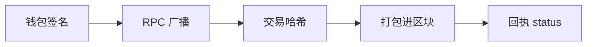

# W02-A 交易哈希、Nonce、Gas、回执与 RPC

> 本文件为第 2 周任务 A（W02-A）的学习笔记，内容来自语音课讲解。

## 1. 交易哈希
- 每笔交易唯一的标识，类似身份证号。
- 可以在区块浏览器（如 Etherscan）上用它查询交易。

## 2. Nonce
- 发送者账户的交易计数器，从 0 开始，每发一笔加 1。
- 保证交易按正确顺序执行，也防止同一笔交易被重复提交。

## 3. Gas
- 交易手续费的计量单位：手续费 = 实际使用的 Gas × Gas 价格。
- 作用：防止网络被垃圾交易刷爆。
- 交易失败，已用掉的 Gas 照样要付。

## 4. 回执（Receipt）
- 交易被打包进区块后返回。
- **status 是关键字段：1 = 成功，0 = 失败。**
- ⚠️ 有交易哈希 ≠ 执行成功，一定要看回执。
- 回执还包括：区块号、实际使用的 Gas、合约地址（部署合约时才有）。

## 5. RPC
- 应用和节点之间的"管道"。
- MetaMask 就是通过 RPC 发送交易、查询余额。

## 6. JSON-RPC 请求格式
JSON-RPC 是一种标准：请求是一个 JSON 对象，必填字段：
| 字段 | 含义 |
|---|---|
| jsonrpc | 固定为 "2.0" |
| id | 请求编号，数字或字符串 |
| method | 方法名 |
| params | 参数数组 |

例 1：查询最新区块号
```json
{"jsonrpc":"2.0","id":1,"method":"eth_blockNumber","params":[]}
```
响应会带回相同的 id，结果放在 result 字段里。

例 2：查询余额（"latest" 表示查最新区块的余额）
```json
{"jsonrpc":"2.0","id":1,"method":"eth_getBalance","params":["0x地址","latest"]}
```
节点返回相同的 id，result 是十六进制表示的 wei 余额。

## 7. 补充说明
- JSON-RPC 不只用于交易，也用于查余额、查区块号、估算 Gas 等。
- 发送交易只是其中一种方法。钱包会把**已签名**的交易数据通过 `eth_sendRawTransaction` 交给节点，节点负责广播。
- 合约函数要等交易上链后才真正执行；调用哪个函数、传什么参数，编码在交易的 data 字段里。

## 8. 钱包签名
- 钱包用私钥对交易内容生成签名，证明这笔交易是本人授权的。
- 签名后别人无法篡改交易内容，改了签名就对不上。

## 9. 流程图

